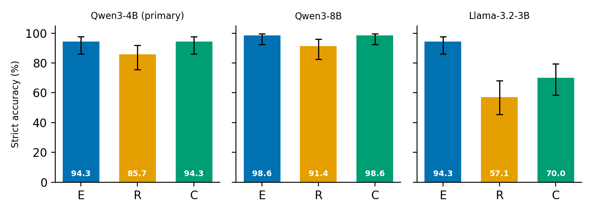

# From Answer Formatting to Operation-Word Misreading: Auditing Hinglish Math Evaluation

*Anonymous submission to the EACL 2027 Student Research Workshop (short paper). DRAFT, not for circulation.*

<!-- Conventions: [VERIFY: ...] = check against a primary source before submission. [PLACEHOLDER: ...] = fill only from verified paper_analysis/ outputs of the frozen, reviewed pilot runs. No pilot result exists at the time of drafting. -->

## Abstract

Many Indian users ask mathematical questions in Hinglish, Hindi and English mixed in Roman script. We ask whether the language form of an otherwise identical word problem changes whether a small open LLM solves it. Each problem family is rendered as English (E), Romanized Hindi (R) and Roman-script code-mixed Hinglish (C). Gold answers are computed in code, every rendering is verified blind by two LLM solvers, and bilingual humans review the families. Before the pilot, we ran 36 permanently excluded fixture prompts through the frozen pipeline. The original answer-format instruction made 10/36 Qwen3-4B outputs fail strict scoring, mostly through unit words appended to dimensionless answers. It also pushed 8/12 Romanized-Hindi explanations into Devanagari. One disclosed prompt revision reduced both to zero. Screening seven models under the frozen protocol showed that strict-format compliance is strongly model-specific. The errors that remained involved the Romanized-Hindi operation words *bhaag* (divide) and *bhinn* (fraction, but also "different"). One *bhinn* misreading recurred in a second model family. On 70 human-reviewed families (210 prompts per model) evaluated under a pre-registered plan, Romanized Hindi is the weakest form for all three backbones: Qwen3-4B scores 94.3/85.7/94.3% on E/R/C, Qwen3-8B 98.6/91.4/98.6%, and Llama-3.2-3B 94.3/57.1/70.0%. Code-mixed input is as easy as English for both Qwen models, while the Romanized-Hindi deficit ranges from about 8 to 37 points across models. The R errors are not concentrated in items with Hindi operation words, so the misreading hypothesis suggested by development data is not supported.

## 1 Introduction

A model that answers "How many marbles does Aman have?" may fail on "Aman ke paas kitne kanche hain?" even though the mathematics is identical. A drop in accuracy could come from Hindi vocabulary, Roman-script spelling, within-sentence mixing, harder wording or the evaluation protocol itself. Comparisons of unrelated English and Hinglish questions cannot tell these apart. We therefore hold the mathematics fixed and vary only the language form: E, R and C.

Lower accuracy on code-mixed or Romanized math inputs has already been reported (Yang and Chai, 2025; Sarvam AI, 2025; Sthanika, 2026), so measuring an E/R/C gap is not new by itself. Our contributions are narrower:

1. **A measurement caution.** On excluded fixtures, a plausible final-answer instruction caused form-dependent scoring failures and output-language drift that would have contaminated an E/R/C comparison. Format compliance also varied widely across seven models.
2. **A paired, reviewed E/R/C resource with operation-word design.** It combines code-computed gold, blind dual-LLM solving, human review, and Hindi operation words that C either keeps or switches to English in balanced proportions.
3. **A frozen diagnostic pilot** with a strict primary endpoint, a numeric secondary endpoint and a manual error audit.

All development evidence (§5) comes from 36 prompts in 12 fixture families that are permanently excluded from every evaluation and training split. None of it is a pilot result.

## 2 Related Work

**Hindi and multilingual math.** MGSM translates GSM8K (Cobbe et al., 2021) into ten languages, but not Hindi (Shi et al., 2023). GSM8K-Hi is a human-reviewed machine translation of the GSM8K test set into Devanagari (Kamath et al., 2025). HAWP has 2,336 Hindi arithmetic problems (Sharma et al., 2022). Anand et al. (2025) tune models on Hindi and English mathematics and explicitly exclude Romanized Hindi. mCoT (Lai and Nissim, 2024), MathOctopus [VERIFY: authors] (2024) and XCOT [VERIFY: authors] (2025) study multilingual math training; XCOT keeps English responses for translated queries.

**Code-mixed and Romanized evaluation.** CodeMixBench's Hindi–English GSM8K mixes Devanagari with Latin script, and models score lower on it than on English (Yang and Chai, 2025). Indi-RomCoM varies Romanized code-mixing intensity (Das et al., 2026, preprint). CodeMixTax aligns GSM8K across five script and register forms, including Romanized Hindi and Hinglish (Sthanika, 2026, author report). The Sarvam-M report shows GSM8K accuracy falling from native-script to Romanized Indic input for every listed model (Sarvam AI, 2025). A similar Romanized-input penalty appears for health queries (Khullar et al., 2025, preprint). These resources all derive from GSM8K or use machine-generated mixing. Ours are newly drafted, all three forms are in Roman script, and humans reviewed them.

**Operation cues and spelling.** Math solvers exploit shallow cues (Patel et al., 2021), and LLMs turn irrelevant phrases into operations (Mirzadeh et al., 2024). Romanized Hindi has no standard orthography (Bali et al., 2014; Roark et al., 2020). Token counts differ widely across languages (Petrov et al., 2023), but fertility predicts accuracy unreliably, so we treat token counts only as correlates. A bounded search did not locate a study isolating Hindi or Romanized-Hindi operation-word polysemy as a cause of LLM math errors. This reflects the limits of our search and is not a novelty claim.

## 3 Data

**Families and forms.** A family is one problem with three renderings. **E** is English. **R** is Hindi phrasing in Roman script, with a borrowing list for numbers, units and established loanwords. **C** is Roman-script Hindi containing English lexical material beyond that list. Topics are comparison/remaining quantity, two-step money, fractions/percentages, ratios, rates/units and elementary algebra. The original pilot has 30 families (five per topic), and Pilot-B adds 70 (12/12/12/12/11/11). Analyses pair forms within a family, so 100 families are not 300 independent problems.

**AI drafting, code-computed gold and blind verification.** All families were drafted by LLMs. Claude (claude-opus-5-5) drafted Pilot-B. A separate Phase-2 set (100 FINAL_TEST, 40 DEV, 160 TRAIN) was drafted by GPT for test and development and by Claude for training [VERIFY: GPT model version; drafting model of the original 30]. Gold answers are computed in code from a structured specification, and drafters were told not to consult benchmark, pilot or fixture text. Claude and GPT each solved every rendering in a fresh context, with no gold, equations or sibling renderings. No Qwen model ever drafted, solved or checked. On Pilot-B, both solvers matched gold on 210/210 first-version renderings and 15/15 revised renderings. On 900 Phase-2 renderings, Claude matched 900/900 and GPT 897/900; all three misses fell in one family, whose gold was confirmed by hand. A cross-form number-multiset check flagged 234/300 families, mostly because of extraction conventions. Before any review, we therefore fixed a stricter routing rule: flag a family on any solver miss, solver disagreement or ambiguity note, or when both solvers extract different number sets across forms. Solver agreement shows only that the text encodes the specified calculation, and the two solvers may share blind spots.

**Bilingual human review.** Each of the original 30 families gets two independent blind solves and an adjudicator [VERIFY: completion status of R01/R02 review and A01 adjudication]. One bilingual team member reviewed all of Pilot-B: 57 ACCEPT, 13 REVISE, 0 REJECT, with two equivalence failures. The reviewer's fixes were applied verbatim as a new version. One bilingual team member also reviewed all of FINAL_TEST [VERIFY: same reviewer as Pilot-B], giving 32 ACCEPT and 68 REVISE. The main finding: **GPT-drafted Romanized Hindi was systematically over-formal. 68/100 GPT-drafted families needed repair, against 13/70 Claude-drafted families.** This comparison is descriptive only. Drafter is confounded with split, prompt and review timing, and the counts are family-level dispositions [VERIFY: share of REVISE decisions that targeted R]. The reviewer also confirmed AI-assistant edits that kept R distinct from C (53 OK, 30 EDIT, 5 MINE) [VERIFY: define EDIT/MINE]. No second annotator has reviewed these families yet.

**C as insertional Hinglish.** The original C definition required productive English clauses. The reviewer's fixes showed that natural Hinglish is mostly *insertional*: Hindi grammar with English nouns, conjunct verbs and relation words, as in *apples aur bananas ka ratio 3:7 hai* or *23 add karta hai*. Full English clauses inside Hindi read as unnatural. For Pilot-B and Phase 2, C therefore requires English lexical material beyond R's borrowing list but no English clause. R's borrowing list gained *type karna*, *cousin* and accepted loan nouns (e.g., *samosa*, *petrol*, *auto*). The original 30 keep the earlier definition and are reported separately.

**Operation-word lexicon and keep/switch balance.** An AI research assistant proposed 25 Hindi operation and relation word families with spelling variants. Each family is flagged as lexically ambiguous (e.g., *bhinn* "fraction"/"different"; *bhaag* "part, divide"/"run") or context-dependent (e.g., *kam*). One bilingual team member reviewed all entries. Entries 1–12 were answered in the reviewer's own words. Entries 13–25 were drafted with AI or dictionary help and then endorsed. Entry 6 (*anupat*, ratio) remains unconfirmed, and there was no second annotation. On the 30 original drafts, a fixed matcher finds lexicon words in 27/30 R but only 10/30 C renderings. For ambiguous families the counts are 19/30 and 5/30; for *bhaag*/*bhinn*, 2/30 and 0/30. A C advantage there could therefore partly reflect easier vocabulary. Pilot-B counters this: C *keeps* R's Hindi operation word in 18 families, *switches* it to English in 17, and 35 are controls with no Hindi operation word. FINAL_TEST and DEV follow the same design (25/25/50; 10/10/20) [VERIFY: these are first-version drafting tags; recount on accepted text with the frozen matcher].

## 4 Protocol

**Prompt.** One English instruction is used for every form (`test1-english-final-v2`). It asks for a short explanation in English, even for non-English questions. The final line must begin `FINAL:`, followed by an English unit only when the answer has one and by nothing after a pure number [VERIFY: quote exact text in appendix]. The prompt was revised once on excluded data (§5) and then frozen.

**Scoring.** The primary endpoint is a frozen strict scorer (v1.0.0). It requires exactly one terminal `FINAL:` line, an exact rational value, and a unit validated against pre-declared aliases and conversions. Missing, refused, ambiguous and truncated answers count as wrong. The secondary endpoint, `numeric_literal_v1`, was adopted before the pilot. It checks whether the literal value on the sole FINAL line equals gold. It is always reported beside the strict endpoint, never instead of it. Disagreement between the two endpoints does not prove a format-only error, because the numeric check can accept wrong units or reject converted ones. We report Wilson 95% intervals per form, and paired E−R, E−C and R−C differences with 10,000 family-bootstrap resamples. One bilingual auditor tags every output with a fixed taxonomy (truncated, refusal, unresolved, misread_quantity, wrong_relation_operation, arithmetic_slip, unit_error, format_only, language_drift, no_error) and an English-compliance tag. Disagreements with automatic scores are spot-checked [VERIFY: auditor/spot-checker assignment for Pilot-B].

**Models.** The primary backbone is Qwen3-4B (Qwen Team, 2025) at pinned revision `1cfa9a7208912126459214e8b04321603b3df60c`. Settings: NF4 4-bit double quantization (Dettmers et al., 2023), FP16 compute, thinking disabled, greedy decoding, batch size 1, a 1,024-token cap, a fresh context per prompt, and one infrastructure retry, on a Colab T4. Qwen3-8B and Llama-3.2-3B-Instruct (chat-template date pinned) are secondary, descriptive backbones under the identical protocol. Both passed a rule declared before screening: at most 3/36 strict-invalid fixture outputs under the unchanged prompt and scorer, with no per-model tuning.

## 5 Development Findings (excluded fixtures, not results)

Everything in this section comes from 36 prompts (12 families × E/R/C). The prompts were AI-authored, not human-reviewed, and are **permanently excluded** from the pilot and all later data. With 12 prompts per form, every rate is only an indication.

**Format confound and v1→v2.** Under the original instruction (`FINAL: <number or fraction> <unit when applicable>`), 10/36 Qwen3-4B outputs were strict-invalid, all coded `invalid_unit`. In 8, the model appended a unit word to a dimensionless answer (`8 unitless`, `24 unit.`, `7/27 positions.`), roughly equally across forms. In one R output, a Hindi noun from the question appeared as the unit (`109 moti`). The original pilot has six dimensionless families, so v1 would have failed correct answers in every form. With v2, there were 0/36 invalid outputs, and the strict and numeric endpoints agreed on all 36 (Table 1). The fixtures also changed between runs (one ambiguous R rendering was repaired and one alias added), so 10→0 is a development comparison, not an isolated prompt effect. The revision is a disclosed, versioned decision, and prompt iteration stopped there.

**Devanagari drift.** Under v1, 8/12 R explanations contained Devanagari despite the English instruction, against 0/12 for E and for C. Under v2 the count was 0/12. The script detector is a heuristic, so the pilot also tags English compliance manually.

*Table 1: Qwen3-4B on the excluded fixtures (12 prompts per form).*

| Prompt | Strict-invalid | Strict correct E / R / C | R with Devanagari |
|---|---:|---|---:|
| v1 | 10/36 | 9 / 7 / 9 | 8/12 |
| v2 | 0/36 | 12 / 10 / 12 | 0/12 |

**Cross-model format compliance.** We ran six more models on the same prompts under frozen v2 (Table 2). Phi-4-mini often wrote FINAL inline, which both endpoints reject, and it fell into repetition on 6/12 R prompts until it hit the token cap. Its C > E ordering (11 vs 6) is therefore a formatting artifact. Granite-3.3-2B appended commentary after FINAL (`FINAL: 24, (units: none)`). Qwen3-1.7B echoed the instruction's wording onto the FINAL line. Gemma-3-4B loaded, but every generation failed with a CUDA error under FP16, possibly from overflow (unconfirmed). Within Qwen3, instruction following broke before mathematics did: 36/36 invalid at 1.7B against 0/36 at 4B and 8B. A frozen prompt and scorer cannot simply be carried across model families. Without a compliance check on excluded data, a multi-model E/R/C comparison would mostly measure formatting.

*Table 2: Format screening on the excluded fixtures, prompt v2, 12 prompts per form. Phi-4-mini and Granite were excluded before the ≤3/36 rule was formalized; both exceed it.*

| Model | Invalid | Correct E / R / C | Dominant failure | Pilot |
|---|---:|---|---|---|
| Qwen3-1.7B | 36/36 | 0 / 0 / 0 | instruction echo | excluded |
| Qwen3-4B | 0/36 | 12 / 10 / 12 | two R operation-word misreadings | primary |
| Qwen3-8B | 0/36 | 12 / 12 / 12 | none (one R output in Devanagari) | secondary |
| Llama-3.2-3B | 2/36 | 12 / 9 / 9 | value errors in R and C | secondary |
| Phi-4-mini | 14/36 | 6 / 4 / 11 | inline FINAL; R repetition | excluded |
| Granite-3.3-2B | 36/36 | 0 / 0 / 0 | commentary after FINAL | excluded |
| Gemma-3-4B | no outputs | — | CUDA error under FP16 | excluded |

**Repeated *bhaag*/*bhinn* misreadings.** Under v2, Qwen3-4B's only errors were two R items, and the renderings were judged correct [VERIFY: judged by an AI assistant, not independent bilingual validation]. In FMT2-005-R, *bhaag dekar bhinn likho* ("divide, write as a fraction") was answered as a difference. In FMT2-006-R, *kitna bhinn istemaal hua* ("what fraction was used") received the remaining count (20) under both v1 and v2. Llama-3.2-3B gave the same answer, 20, so this misreading occurs in a second model family. Llama also looped to the token cap on FMT2-005-R. Qwen3-8B answered both items correctly. *Bhinn* means both "fraction" and "different" even in Devanagari, so the ambiguity is lexical rather than only orthographic. With n=2 items on unreviewed fixtures, these errors are *consistent with* operation-word misreading but do not establish it. They motivated the lexicon and the keep/switch design, both fixed before any pilot output.

## 6 Pilot Results

We report the Pilot-B cohort (70 families, single bilingual reviewer; Section 3). Analysis followed `pilot_b/PREREGISTRATION.md`, committed before any Pilot-B output. Each backbone ran once; all three runs completed 210/210 renderings, with no infrastructure failures, verified checksums, and tables reproduced exactly from stored scores. The original 30-family pilot, under two-reviewer adjudication, is reported separately once complete [VERIFY: R01/R02/A01 status] and is never pooled with Pilot-B.

**Table 3: Strict accuracy by form (Pilot-B, 70 families).** Accuracy % with 95% Wilson intervals; *invalid* = strict-invalid outputs (truncated in parentheses). No refusals occurred.

| Backbone | E | R | C | Invalid E / R / C |
|---|---|---|---|---|
| Qwen3-4B (primary) | 94.3 [86.2, 97.8] | 85.7 [75.7, 92.1] | 94.3 [86.2, 97.8] | 3 / 2 / 1 |
| Qwen3-8B | 98.6 [92.3, 99.7] | 91.4 [82.5, 96.0] | 98.6 [92.3, 99.7] | 1 / 1 / 0 |
| Llama-3.2-3B | 94.3 [86.2, 97.8] | 57.1 [45.5, 68.1] | 70.0 [58.5, 79.5] | 1 / 6 (5) / 4 (2) |

**Table 4: Paired family differences** (percentage points; 10,000 family-bootstrap resamples, seed 101; discordant families as first-only / second-only correct).

| Backbone | E−R | E−C | R−C |
|---|---|---|---|
| Qwen3-4B | +8.6 [−1.4, +18.6] (9/3) | 0.0 [−7.1, +7.1] (3/3) | −8.6 [−15.7, −1.4] (1/7) |
| Qwen3-8B | +7.1 [0.0, +14.3] (6/1) | 0.0 [−4.3, +4.3] (1/1) | −7.1 [−14.3, 0.0] (1/6) |
| Llama-3.2-3B | +37.1 [+24.3, +50.0] (28/2) | +24.3 [+11.4, +37.1] (21/4) | −12.9 [−27.1, +1.4] (10/19) |

*Figure 1: Strict accuracy by form with 95% Wilson intervals, Pilot-B (70 families per bar).*

**Romanized Hindi is the hard case.** R is the lowest-scoring form for every backbone. The deficit is modest for Qwen (8.6 and 7.1 points; intervals touch zero) and large for Llama (37.1 points, interval [+24.3, +50.0]; 28 families correct only in E against 2 only in R). Within the Qwen family, moving from 4B to 8B improves all forms but leaves the R deficit roughly unchanged.

**Code-mixing is not the problem.** For both Qwen models, C matches E exactly (E−C = 0.0) and exceeds R; for Qwen3-4B the R−C interval excludes zero (7 families correct only in C against 1 only in R). For Llama, C lies between E and R. Under our design, which holds the mathematics and the English output instruction fixed, mixing in English lexical material does not hurt and appears to help relative to Romanized Hindi alone.

**The operation-word hypothesis is not supported.** Section 5 motivated a pre-registered descriptive split by whether R contains a Hindi operation word and whether C keeps or switches it. R accuracy is similar across strata for every model: Qwen3-4B 89% (keep), 82% (switch), 86% (none); Qwen3-8B 94/94/89%; Llama 67/59/51%. The R deficit is therefore not concentrated in items with *bhaag*/*bhinn*-type vocabulary. Many Llama R errors are arithmetic slips on simple items, for example 1200 − 3×265 answered as 435.

**Residual format effects.** The secondary numeric endpoint agrees with strict scoring on every Llama rendering, so the gaps are not formatting artifacts. For the Qwen models, the pre-registered secondary grammar does not accept a *trailing* rupee symbol (`FINAL: 1575 ₹`), which strict scoring accepts. This accounts for every strict-correct/numeric-fail case (30 for Qwen3-4B, 36 for Qwen3-8B). We report the secondary endpoint as specified and note that a post-hoc allowance for the trailing symbol restores agreement. Three of Qwen3-4B's four E failures are numerically correct answers with unlisted English unit phrases (`11 years old`, `4 bags of cement`); one C failure is an unlisted spelling (`300 rupye`), the form-dependent alias penalty anticipated in Section 5.

**Exploratory (not pre-registered).** Despite the English-explanation instruction, Llama explained 60/70 R and 27/70 C outputs in romanized-Hindi prose (heuristic detection). On C, Hindi-prose explanations were correct 13/27 against 36/43 for English explanations. This association is confounded by item difficulty and awaits the planned English-compliance audit [PLACEHOLDER: audit results, Table 5].

*Table 5 (planned): primary-backbone audit of R and C outputs (error taxonomy, English-compliance tags) by operation-word stratum. [PLACEHOLDER: requires the verified audit sidecar.]*

## 7 Limitations

- **Diagnostic scale.** With at most 100 families per backbone, the vocabulary strata are sparse and descriptive.
- **Thin development evidence.** §5 rests on 12 unreviewed fixture families, and the prompt was revised after seeing their outputs. No pilot item was used to design the prompt.
- **Single reviewer.** Pilot-B, FINAL_TEST and the lexicon each had one bilingual reviewer, who is a team member. Part of the lexicon was AI-assisted, and *anupat* is unconfirmed. Naturalness judgments reflect one speaker's register.
- **AI-authored data.** Items share LLM drafting styles. Claude both drafted and solved Pilot-B. The GPT/Claude repair contrast is confounded with split and prompt.
- **Different C definitions.** The original 30 and Pilot-B define C differently, which prevents a simple pooled C estimate.
- **Models.** All backbones are small, quantized, greedy and non-thinking. Admitting models by format compliance excludes families whose formatting the scorer does not accept.
- **No script control.** There is no Devanagari arm, so an E–R gap mixes script, language, register and spelling. C ≈ E with R < E would suggest vocabulary but would not identify it. Each R rendering is one of many possible spellings.
- **Contamination.** The items are new, but the models' pretraining data cannot be audited.

## Ethics Statement

**Consent and credit.** Reviewers received a consent note covering the task, data use and release [VERIFY: signed consent and exposure records for every reviewer; roles (team member or external); any compensation]. Reviewers will be credited in the camera-ready acknowledgments or as authors, as appropriate and according to their stated preference [VERIFY]. Real identities stay out of shared ledgers.

**AI-assistance disclosure.** (1) *AI-drafted items:* every rendering was drafted by an LLM (Claude for Pilot-B and the training split, GPT for test and development [VERIFY: original 30]). The families were then checked against code-computed gold, verified blind by two LLM solvers and reviewed by humans. (2) *AI-assisted human review:* humans made every acceptance decision, but some lexicon entries and some text edits were drafted by AI before reviewers confirmed them (§3). (3) *Writing and coding:* AI assistants helped write the evaluation and analysis code, the research notes and this manuscript, and recorded protocol decisions under the authors' delegation. The authors reviewed all of this and take responsibility for it [VERIFY: name the assistant systems per venue policy].

**Data.** The items are invented everyday word problems and are not expected to contain personal information [VERIFY: names/PII check before release]. Romanized Hindi varies by region and register, and our renderings reflect few speakers. Data are released under CC BY 4.0 and code under MIT. FINAL_TEST stays unreleased until the confirmatory evaluation.

## References

- Anand, A., et al. 2025. Multilingual Mathematical Reasoning: Advancing Open-Source LLMs in Hindi and English. *AAAI* 39(22). arXiv:2412.18415.
- Bali, K., et al. 2014. English–Hindi code mixing (Facebook analysis). *Workshop on Computational Approaches to Code Switching*. ACL Anthology W14-3914. [VERIFY: full title and author list]
- Chai, L., et al. 2025. XCOT (cross-lingual chain-of-thought instruction tuning). *AAAI* 39(22), DOI 10.1609/aaai.v39i22.34524. [VERIFY: authors and title]
- Cobbe, K., et al. 2021. Training Verifiers to Solve Math Word Problems (GSM8K). [VERIFY: title and arXiv ID]
- Das, A., et al. 2026. Indi-RomCoM: Code-Mixed Benchmark for Evaluating LLMs on Romanized Indic-English Instructions. arXiv:2606.30790 (preprint).
- Dettmers, T., et al. 2023. QLoRA: Efficient Finetuning of Quantized LLMs. arXiv:2305.14314.
- Kamath, et al. 2025. GSM8K-Hi (human-reviewed Hindi GSM8K). arXiv:2508.19831. [VERIFY: full title and authors]
- Khullar, et al. 2025. "Script Gap" (Romanized vs native-script health triage). arXiv:2512.10780 (preprint). [VERIFY: title, authors, year]
- Lai, H., and Nissim, M. 2024. mCoT. *ACL 2024*, 2024.acl-long.649. [VERIFY: full title]
- MathOctopus. 2024. *Findings of EMNLP 2024*, 2024.findings-emnlp.411. [VERIFY: authors and title]
- Mirzadeh, I., et al. 2024. GSM-Symbolic. arXiv:2410.05229. [VERIFY: full title]
- Patel, A., Bhattamishra, S., and Goyal, N. 2021. SVAMP. arXiv:2103.07191. [VERIFY: full title and venue]
- Petrov, A., et al. 2023. Tokenizer unfairness between languages. *NeurIPS 2023*. arXiv:2305.15425. [VERIFY: full title]
- Qwen Team. 2025. Qwen3 Technical Report. arXiv:2505.09388.
- Roark, B., et al. 2020. Dakshina dataset. *LREC 2020*, 2020.lrec-1.294. [VERIFY: full title]
- Sarvam AI. 2025. Sarvam-M. Technical blog report, 23 May 2025. https://www.sarvam.ai/blogs/sarvam-m
- Sharma, Mishra and Sharma. 2022. HAWP: Hindi arithmetic word problems. *LREC 2022*, 2022.lrec-1.373. [VERIFY: initials and full title]
- Shi, F., et al. 2023. Language Models are Multilingual Chain-of-Thought Reasoners. *ICLR 2023*. arXiv:2210.03057.
- Sthanika. 2026. The code-mixing tax on romanized Hindi, measured (CodeMixTax). Author research report. https://sthanika.ai/research/codemix-tax-2026
- Yang, Y., and Chai, Y. 2025. CodeMixBench: Evaluating Code-Mixing Capabilities of LLMs Across 18 Languages. *EMNLP 2025*, 2025.emnlp-main.109.
- Model cards, with pinned revisions listed in the appendix: Qwen3-1.7B/4B/8B; Phi-4-mini-instruct; granite-3.3-2b-instruct; gemma-3-4b-it; Llama-3.2-3B-Instruct.
